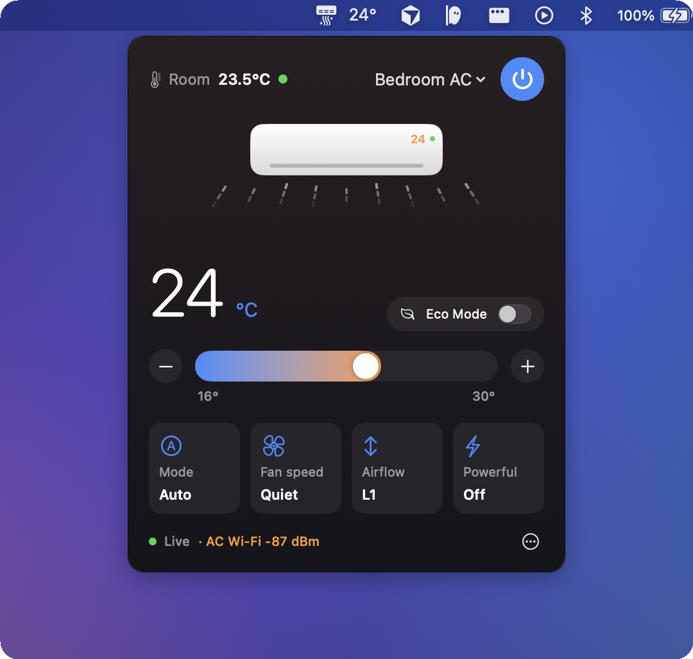
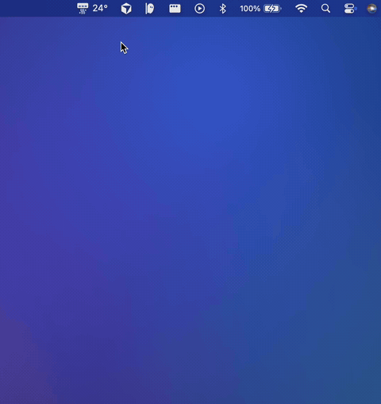
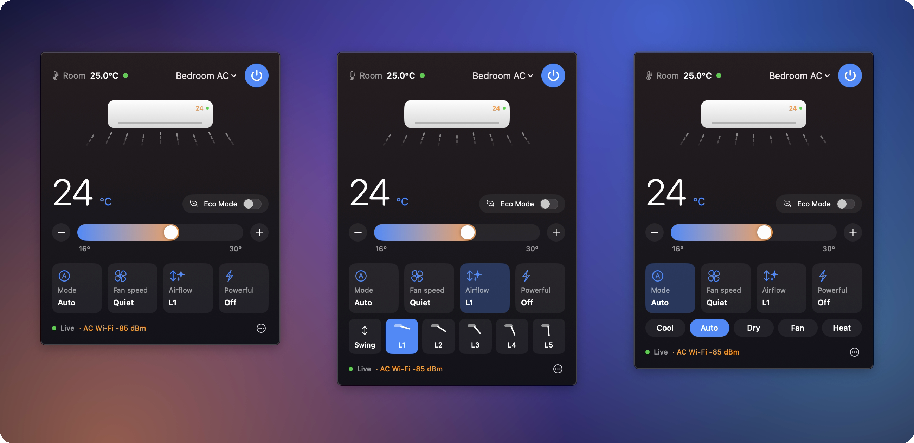

<p align="center">
  
</p>

<h1 align="center">Hawadaar</h1>

<p align="center">
  <b>Control your Panasonic MirAIe air conditioner from your Mac's menu bar.</b><br>
  <sub>ہوادار · Urdu for "airy, breezy"</sub>
</p>

<p align="center">
  <a href="https://github.com/abdulghanitech/hawadaar/releases/latest"></a>
  <a href="https://github.com/abdulghanitech/hawadaar/releases"></a>
  
  
  <a href="LICENSE"></a>
</p>

<p align="center">
  <a href="https://github.com/abdulghanitech/hawadaar/releases/latest"><b>⬇&nbsp; Download Hawadaar for macOS</b></a>
</p>

<p align="center">
  
</p>

## Why

Your AC remote is never where you left it, and the MirAIe app is buried on your phone. Hawadaar puts your AC one click away in the menu bar: see the room temperature, change the setpoint, mode, fan and airflow, and switch between every AC in the house.

<p align="center">
  
</p>

## Features

- **One click away.** The menu bar shows the temperature your AC is set to; click for everything else.
- **Every control.** Power, 16–30 °C slider, Mode, Fan speed, Airflow, Eco, Powerful and the display light.
- **Airflow you can see.** The animation follows the real louver: it sweeps on Swing and changes angle with L1–L5.
- **Always in sync.** Changes from the remote or the MirAIe app appear within a second or two.
- **Every AC in the house.** Switch between all the ACs on your MirAIe account.
- **Find out why your AC keeps dropping off Wi-Fi.** Hawadaar shows the signal each AC reports, warns when it's weak and logs every drop-out.
- **Tiny and native.** SwiftUI, no dependencies, under 1 MB, Apple Silicon and Intel.

<p align="center">
  
</p>

## Install

1. Download **Hawadaar-x.y.z.zip** from the [latest release](https://github.com/abdulghanitech/hawadaar/releases/latest), unzip it and move **Hawadaar.app** to Applications.
2. Hawadaar isn't notarized by Apple yet, so the first launch says *"Apple could not verify Hawadaar"*. Click **Done**, then allow it once:
   - **macOS 15 Sequoia and later:** open **System Settings → Privacy & Security**, scroll down and click **Open Anyway** next to Hawadaar, then confirm.
   - **macOS 14 Sonoma:** right-click **Hawadaar.app → Open → Open**.
   - **Or in Terminal, on any version:**
     ```sh
     xattr -dr com.apple.quarantine /Applications/Hawadaar.app
     ```
3. Click the AC icon in the menu bar and sign in with the mobile number (or email) and password you use in the MirAIe app.

Hawadaar checks for new versions once a day. When one is out, click **Update** in the panel: it downloads, verifies and installs itself, then restarts. No need to download it again.

**Requirements:** macOS 14 Sonoma or later, and an AC set up in the **MirAIe** app.

## FAQ

**Which air conditioners work?**
Panasonic ACs controlled with the [MirAIe](https://www.miraie.in) app, sold mainly in India. Panasonic models that use the global *Comfort Cloud* app are a different system and aren't supported.

**Is it safe to enter my MirAIe password?**
It's stored in the macOS Keychain and only ever sent to MirAIe's own servers, exactly like the MirAIe app. Hawadaar has no analytics and no server of its own, and the code is right here to read.

**Does it work without internet?**
No. MirAIe ACs are controlled through Panasonic's cloud, so Hawadaar needs internet just like the MirAIe app.

**My AC keeps disconnecting. Can Hawadaar help?**
Check *AC Wi-Fi* in the panel footer: anything weaker than about −75 dBm turns orange and is likely to drop. *⋯ → Open Connection Log* shows exactly when your AC went offline. If the signal is weak even right next to your router, the AC's Wi-Fi module may need servicing.

**Why "Hawadaar"?**
*Hawadaar* (ہوادار) is Urdu for "airy, breezy, well-ventilated", which is what you want your room to be, one click away.

## Roadmap

Ideas and contributions are welcome; open an issue to discuss.

- [ ] Sleep mode
- [ ] Horizontal swing for models that support it
- [ ] Schedules and timers
- [ ] macOS widgets and Shortcuts actions
- [ ] Notarized builds and Homebrew

## Build from source

Requires Xcode 16 or the Command Line Tools for Xcode 16 (Swift 6).

```sh
git clone https://github.com/abdulghanitech/hawadaar.git
cd hawadaar
make run     # build build/Hawadaar.app and launch it
make test    # run the unit tests
make zip     # universal (Apple Silicon + Intel) release zip in build/
```

The MirAIe protocol code lives in the `HawadaarCore` library and the menu bar app in `Hawadaar`. [docs/PROTOCOL.md](docs/PROTOCOL.md) documents the endpoints, MQTT topics and command fields.

## Credits

The MirAIe protocol was worked out by the community. Hawadaar builds on the research in [rkzofficial/miraie-ac](https://github.com/rkzofficial/miraie-ac) and [selvakk2k/miraie-ac-in](https://github.com/selvakk2k/miraie-ac-in).

Hawadaar is an independent project, not affiliated with or endorsed by Panasonic. Panasonic and MirAIe are trademarks of their respective owners. It uses an unofficial API that may change without notice.

## License

[MIT](LICENSE)

---

<p align="center">
  Made by <a href="https://abdulghani.tech">Abdul Ghani</a>.<br>
  If Hawadaar keeps you cool, a ⭐ helps other people find it.
</p>
