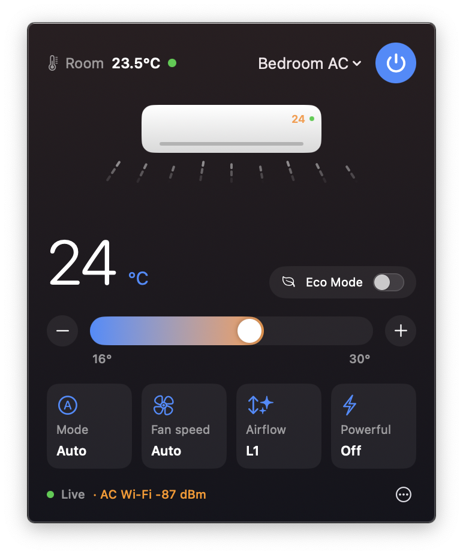
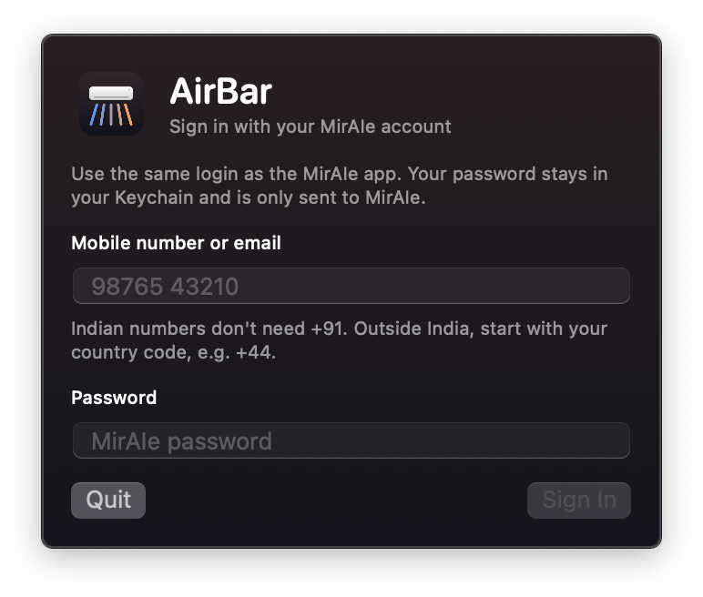

<p align="center">
  
</p>

<h1 align="center">AirBar</h1>

<p align="center">
  <b>Control your Panasonic MirAIe air conditioner from the macOS menu bar.</b><br>
  No more reaching for your phone or hunting for the remote.
</p>

<p align="center">
  <a href="https://github.com/abdulghanitech/airbar/releases/latest"></a>
  <a href="https://github.com/abdulghanitech/airbar/releases"></a>
  
  
  <a href="LICENSE"></a>
</p>

<p align="center">
  
</p>

<p align="center">
  <a href="https://github.com/abdulghanitech/airbar/releases/latest"><b>⬇ Download AirBar for macOS</b></a>
</p>

## Features

- **One click away.** The menu bar shows the temperature your AC is set to; click it for room temperature, power, a 16–30 °C slider, and Mode, Fan speed, Airflow, Eco and Powerful controls.
- **Airflow you can see.** The animation follows the real louver: it sweeps on Swing and changes angle with positions L1–L5.
- **Always in sync.** Changes made with the remote or the MirAIe app show up within a second or two.
- **Every AC in the house.** Switch between all the ACs on your MirAIe account.
- **Find out why your AC keeps going offline.** AirBar shows the Wi-Fi signal each AC reports, warns when it's weak, and logs every drop-out.
- **Tiny and native.** SwiftUI, no dependencies, under 1 MB, runs on Apple Silicon and Intel.

| Control panel | Sign in |
|---|---|
|  |  |

## Install

1. Download **AirBar-x.y.z.zip** from the [latest release](https://github.com/abdulghanitech/airbar/releases/latest), unzip it and move **AirBar.app** to Applications.
2. Open it. AirBar isn't notarized by Apple yet, so the first time macOS will say it can't verify the developer: right-click **AirBar.app → Open → Open**. Or run:
   ```sh
   xattr -dr com.apple.quarantine /Applications/AirBar.app
   ```
3. Click the AC icon in the menu bar and sign in with the mobile number (or email) and password you use in the MirAIe app.

AirBar checks for new versions once a day and shows an **Update** button when one is out.

**Requirements:** macOS 14 Sonoma or later, and an AC that's set up in the **MirAIe** app.

## FAQ

**Which air conditioners work?**
Panasonic ACs controlled with the [MirAIe](https://www.miraie.in) app, sold mainly in India. Panasonic models that use the global *Comfort Cloud* app are a different system and aren't supported.

**Is it safe to enter my MirAIe password?**
Your password is stored in the macOS Keychain and only ever sent to MirAIe's own servers, exactly like the MirAIe app does. AirBar has no analytics and no server of its own, and the code is right here to read.

**Does it work without internet?**
No. MirAIe ACs are controlled through Panasonic's cloud, so AirBar needs internet just like the MirAIe app.

**My AC keeps disconnecting. Can AirBar help?**
Look at *AC Wi-Fi* in the panel footer. Anything weaker than about −75 dBm is shown in orange and is likely to drop. *⋯ → Open Connection Log* shows exactly when your AC went offline. If the signal is weak even right next to your router, the AC's Wi-Fi module may need servicing.

## Roadmap

Ideas and contributions welcome; open an issue to discuss.

- [ ] Sleep mode
- [ ] Horizontal swing for models that support it
- [ ] Schedules and timers
- [ ] macOS widgets and Shortcuts actions
- [ ] Signed and notarized builds

## Build from source

Requires Xcode 16 or the Command Line Tools for Xcode 16 (Swift 6).

```sh
git clone https://github.com/abdulghanitech/airbar.git
cd airbar
make run     # build build/AirBar.app and launch it
make test    # run the unit tests
make zip     # universal (Apple Silicon + Intel) release zip in build/
```

The MirAIe protocol code lives in the `AirBarCore` library, and the menu bar app in `AirBar`. [docs/PROTOCOL.md](docs/PROTOCOL.md) documents the endpoints, MQTT topics and command fields.

## Credits

The MirAIe protocol was worked out by the community. AirBar builds on the research in [rkzofficial/miraie-ac](https://github.com/rkzofficial/miraie-ac) and [selvakk2k/miraie-ac-in](https://github.com/selvakk2k/miraie-ac-in).

## Disclaimer

AirBar is an independent project, not affiliated with or endorsed by Panasonic. Panasonic and MirAIe are trademarks of their respective owners. It uses an unofficial API that may change without notice.

## License

[MIT](LICENSE) © Abdul Ghani

---

<p align="center">If AirBar keeps you cool, a ⭐ helps other people find it.</p>
